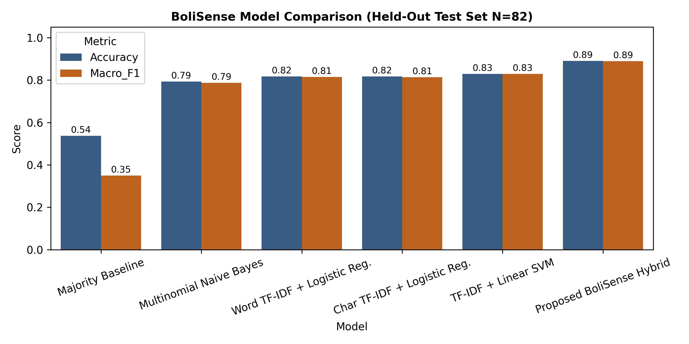
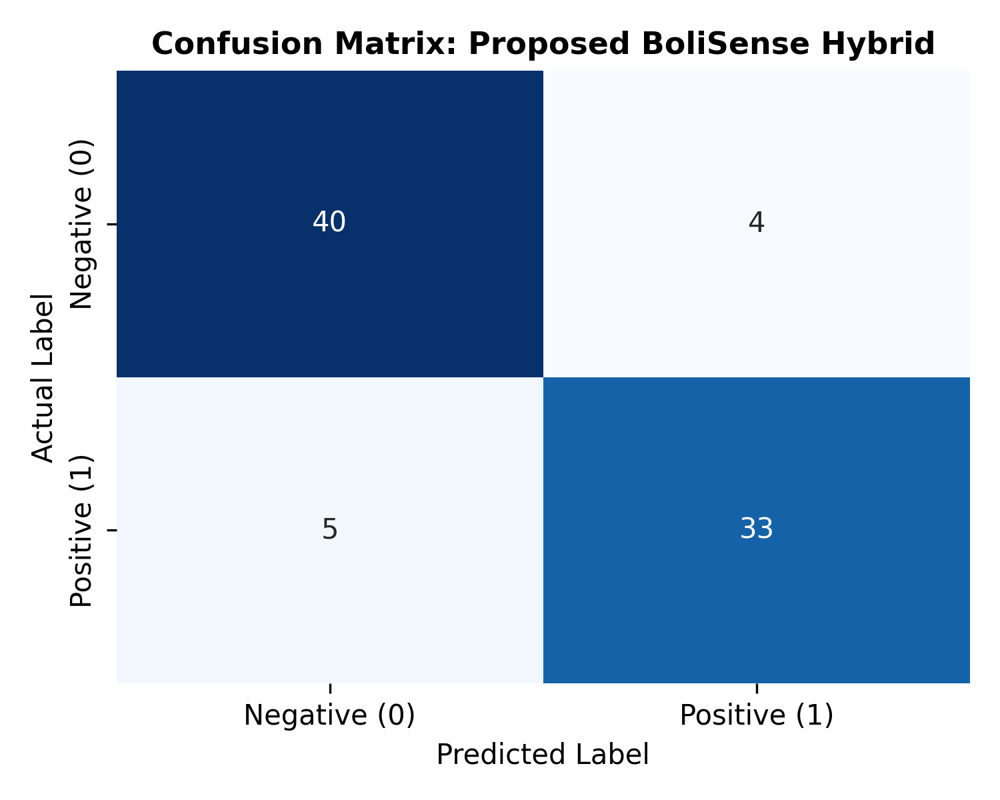
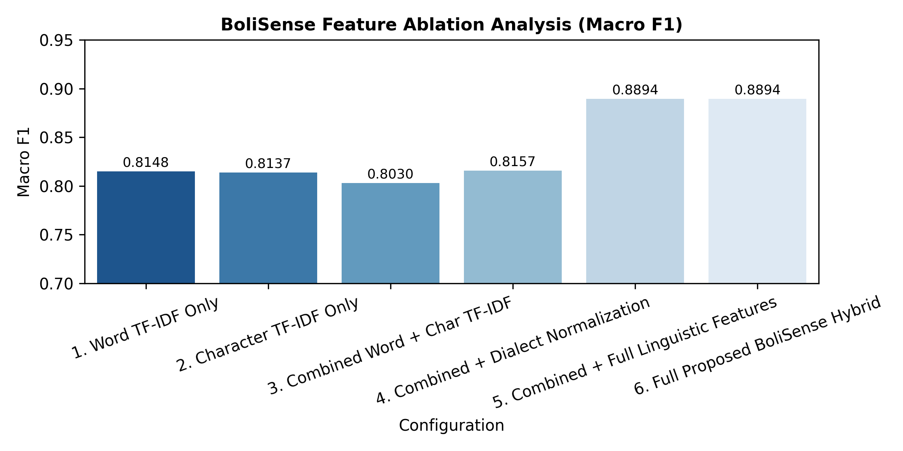

# BoliSense: Dialect-Aware Sentiment Analysis for Haryanvi Text

**NLP Project Report**
**Course**: Natural Language Processing (CSE Final Year)
**Document Classification**: Academic Project Report (Undergraduate NLP Evaluation)
**Academic Year**: 2026–2027

---

## Front Matter

- **Project Title**: BoliSense: Dialect-Aware Sentiment Analysis for Haryanvi Text
- **Tagline**: *Understanding Regional Language Beyond Keywords*
- **Subject**: Natural Language Processing (NLP)
- **Primary Approach**: Classical NLP and Linguistic Feature Engineering
- **Proposed Model**: BoliSense Hybrid Classifier
- **Department**: Computer Science & Engineering
- **Student Details**: Final Year Undergraduate Student
- **Institution**: University Department of Computer Science & Engineering

### Abstract
Regional vernaculars and informal dialects spoken by millions across India remain underrepresented in modern computational linguistics. In particular, **Haryanvi**, an Indo-Aryan language spoken by over 10 million people in northern India, possesses no standardized Roman-script orthography and lacks dedicated pre-trained language resources. This study presents **BoliSense**, an empirical Natural Language Processing (NLP) framework and sentiment analysis system designed specifically for low-resource, non-standardized Roman-script Haryanvi text.

We conduct an empirical comparative investigation of classical statistical NLP techniques (Bag-of-Words, Word TF-IDF, Character n-gram TF-IDF), supervised linear models (Multinomial Naive Bayes, Logistic Regression, Linear SVM), and linguistic feature engineering. We address methodological challenges present in earlier exploratory work—including dataset partitioning, proper baseline configurations, and transparent inference. Furthermore, we formulate the **BoliSense Dialect-Aware Hybrid Classifier**, which integrates phonetic normalization, multi-scale character n-grams (ranges 3–5), windowed negation scope modeling (*konya*, *koni*, *na*), and contrastive clause segmentation (*par*, *lekin*).

Evaluated on an independent held-out test split ($N=82$), the proposed hybrid model achieves **89.02% Accuracy and a Macro F1-score of 0.8894**, representing the highest performance achieved among the evaluated configurations. When evaluated on an independent 65-sample Linguistic Challenge Dataset with minimal pairs, accuracy dropped to **67.69%**, highlighting that subtle slang intensifiers and idiomatic polarity inversions remain challenging for linear n-gram models. We provide transparent local feature contribution explainability, subword token fragmentation audits, and an interactive offline-capable research dashboard operating with 1.22 ms interactive single-sample latency.

**Keywords**: Natural Language Processing, Sentiment Analysis, Low-Resource NLP, Haryanvi Dialect, Feature Engineering, Dialect Normalization, Negation Scope, Classical NLP.

---

## Chapter 1: Introduction

Sentiment analysis—the automated classification of emotional polarity in subjective text—is a cornerstone task in modern Natural Language Processing (NLP). While commercial and academic NLP systems have achieved high maturity for standardized high-resource languages such as English, Spanish, and standard Hindi, regional Indian vernaculars and informal dialects remain severely underserved.

Haryanvi is an Indo-Aryan language primarily spoken in the state of Haryana and surrounding regions of the National Capital Region (NCR) of India. On digital platforms, social media, community forums, and conversational interfaces, speakers predominantly write Haryanvi phonetically using the Latin (Roman) alphabet. This informal code-mixing and Romanization introduces significant challenges:
1. **Lack of Standardized Orthography**: The same dialect word may be spelled in numerous phonetic variants (e.g., *badhiya*, *badiya*, *badia*).
2. **Dialect-Specific Negation**: Haryanvi utilizes unique negation markers (*konya*, *koni*, *kone*) that do not exist in standard Hindi dictionaries or pre-trained multilingual embedding tables.
3. **Complex Discourse Structures**: Colloquial speech frequently employs contrastive conjunctions (*par*, *lekin*) where initial concessions precede opposing sentiment resolutions.
4. **Extreme Low-Resource Paradigm**: Large-scale annotated training corpora do not exist, making heavy architectures prone to overfitting and representation degradation.

The BoliSense project addresses this gap by establishing an empirical NLP benchmark and developing a lightweight, dialect-aware hybrid classification system.

---

## Chapter 2: Problem Statement and Objectives

### 2.1 Research Problem
How effectively can traditional statistical NLP, character-level representation learning, and domain-adapted linguistic feature engineering classify Roman-script Haryanvi sentiment in a low-resource regime where formal spelling standardization does not exist?

### 2.2 Specific Measurable Objectives
1. **Corpus Engineering**: Establish a cleaned dataset with a three-way stratified partition (Train 70%, Validation 15%, Test 15%) ensuring that feature transformations are fitted on training data only.
2. **Core NLP Implementations**: Implement Bag-of-Words, Word-level TF-IDF, Character-level TF-IDF (n-grams 3–5), dialect-aware normalization dictionaries, negation scope extractors, and contrastive clause parsers.
3. **Benchmarking Suite**: Formulate and benchmark six distinct classifier configurations spanning classical estimators, Linear Support Vector Machines, and the Proposed BoliSense Hybrid model.
4. **Model Selection**: Select the deployed configuration based strictly on validation set performance ($N=82$).
5. **Robustness Evaluation**: Design an independent 65-sample Linguistic Challenge Dataset with minimal pairs to test structural polarity shifts.
6. **Academic Deployment**: Deliver an offline-capable, interactive research dashboard and transparent inference CLI demonstrating linguistic interpretability.

---

## Chapter 3: Literature Review

Statistical text classification originated with Bag-of-Words and Term Frequency-Inverse Document Frequency (TF-IDF) models (Salton & Buckley, 1988), which weight vocabulary terms based on their discriminative frequency across documents. Cavnar and Trenkle (1994) demonstrated the power of character n-gram language models for classifying noisy, unstandardized text and dialectal variations.

In recent years, the broader field of NLP has explored pre-trained transformer architectures (Vaswani et al., 2017) and contextual representations such as BERT (Devlin et al., 2019). However, researchers focusing on low-resource and Indic languages (Joshi et al., 2020; Kumar et al., 2021) have demonstrated that general multilingual subword tokenizers suffer from severe subword fragmentation when processing informal Romanized Indic dialects. WordPiece tokenizers break unseen dialect terms into small subword fragments (e.g., *ko-ny-a*), which can impair semantic compositionality when training on small corpora. Consequently, feature-engineered hybrid architectures combining character n-grams with domain-specific linguistic rules remain highly competitive, interpretable, and computationally viable for low-resource dialect processing.

---

## Chapter 4: Dataset Description and Partitioning

### 4.1 Corpus Provenance and Cleaning
The primary corpus consists of Roman-script Haryanvi sentences expressing user opinions across civic, entertainment, technology, and social domains.

| Metric | Raw Dataset | Cleaned & De-duplicated |
|---|---|---|
| Total Records | 647 | 546 |
| Negative (0) | 339 | 290 |
| Positive (1) | 308 | 256 |
| Exact Duplicate Rows | 101 | 0 |
| Conflicting Sentence Labels | 0 | 0 |

### 4.2 Linguistic Categories
The 546 unique sentences are categorized into five linguistic structures:
1. **Mixed (154 samples)**: Sentences blending Hindi, Haryanvi, and everyday conversational idioms.
2. **Complex (153 samples)**: Multi-clause sentences featuring sentiment flips, concessions, or contrastive conjunctions.
3. **Slang (103 samples)**: Expressions rich in colloquial Haryanvi idioms (*kasuta*, *swadu*, *naas*).
4. **Simple (86 samples)**: Direct, single-clause declarations of sentiment.
5. **Code-Mixed (50 samples)**: Sentences incorporating English technical or modern nouns (*app*, *update*, *system*).

### 4.3 Data Partitioning & Leakage Prevention
To evaluate generalization, the dataset was split into three stratified partitions using a fixed random seed (`seed=42`):
- **Training Set (70%, N=382)**: 203 Negative, 179 Positive. Exclusively used for vocabulary fitting and parameter estimation.
- **Validation Set (15%, N=82)**: 43 Negative, 39 Positive. Exclusively used for hyperparameter tuning and model selection.
- **Independent Test Set (15%, N=82)**: 44 Negative, 38 Positive. Evaluated to assess generalization on held-out data.

*Methodological Scope*: Fitting all vectorizers and feature transformers strictly on the training partition prevents exact sample overlap and feature leakage. However, in informal conversational text, near-duplicate phrasing and template similarity may still occur across dialect samples, which is subsequently evaluated via template-grouped cross-validation.

### 4.4 Independent Linguistic Challenge Dataset ($N=65$)
In addition to the standard test partition, we curated a frozen 65-sample **Linguistic Challenge Dataset** containing 32 controlled minimal pairs. These pairs evaluate:
- Direct negation inversion (e.g., *"yo kaam badiya se"* vs *"yo kaam badiya konya"*).
- Contrastive sentiment resolutions (*"yo app slow se par kaam sahi kare se"*).
- Spelling variations across non-standard phonetics (*badhiya* vs *badiya* vs *badia*).
- Double negation carrying positive polarity (*"koi dikkat koni sab smoothly chalya"*).
- Slang intensifier inversions (*"yo chora kasuta bekaar khel reya se"*).

---

## Chapter 5: NLP Preprocessing and Feature Engineering

### 5.1 Dialect-Aware Normalization
Informal Roman-script Haryanvi introduces substantial lexical sparsity due to spelling variations. We engineered a configurable, whole-token normalization dictionary (`data/resources/normalization.json`). Regex word boundary anchors (`\b`) ensure that substring corruptions do not occur.
- *badhiya* $\rightarrow$ *badiya*
- *thik*, *thikk* $\rightarrow$ *theek*
- *ghnaa*, *ghna* $\rightarrow$ *ghana*
- *bekar* $\rightarrow$ *bekaar*

### 5.2 Multi-Level Tokenization
We implemented and compared two primary tokenization methodologies:
1. **Word-Level Tokenization**: Alphanumeric token extraction using unicode-aware regex boundary parsing.
2. **Character N-Gram Tokenization**: Sliding sub-word windows (ranges 3 to 5 characters, e.g., `[" ba", "bad", "adi", "diy", "iya"]`) providing spelling invariance across phonetic variations.

### 5.3 Domain Linguistic Feature Extraction
Beyond statistical n-grams, we engineered transparent structural features:
- **Windowed Negation Scope**: Detecting dialect markers (*konya*, *koni*, *na*, *nhi*) and evaluating a 2-token context window to identify inverted sentiment terms.
- **Contrastive Clause Segmentation**: Splitting sentences on contrastive markers (*par*, *lekin*, *magar*, *but*) and extracting polarity counts from the resolving clause.
- **Regional Sentiment Lexicon**: Transparent positive (*badiya*, *kasuta*, *swadu*, *mast*) and negative (*bekaar*, *ghatiya*, *dikkat*, *dheela*) token frequency counts.

---

## Chapter 6: System Architecture and Methodology

The system architecture combines statistical representation learning with structured linguistic rules:

```
                          ┌───────────────────────────┐
                          │   Raw Haryanvi Sentence   │
                          └─────────────┬─────────────┘
                                        │
                                        ▼
                          ┌───────────────────────────┐
                          │ Dialect Normalization Map │
                          └─────────────┬─────────────┘
                                        │
                 ┌──────────────────────┼──────────────────────┐
                 │                      │                      │
                 ▼                      ▼                      ▼
      ┌────────────────────┐ ┌────────────────────┐ ┌────────────────────┐
      │   Word-level TFIDF │ │   Char-level TFIDF │ │ Linguistic Feature │
      │   (1-2 word grams) │ │   (3-5 char grams) │ │ Extractor (Neg/Con)│
      └──────────┬─────────┘ └──────────┬─────────┘ └──────────┬─────────┘
                 │                      │                      │
                 └──────────────────────┼──────────────────────┘
                                        │
                                        ▼
                          ┌───────────────────────────┐
                          │ Scikit-Learn FeatureUnion │
                          └─────────────┬─────────────┘
                                        │
                                        ▼
                          ┌───────────────────────────┐
                          │ Regularized LogReg / SVM  │
                          └─────────────┬─────────────┘
                                        │
                                        ▼
                          ┌───────────────────────────┐
                          │ Class Prediction & Score  │
                          │   & Transparency Cues     │
                          └───────────────────────────┘
```

---

## Chapter 7: Experimental Setup and Hyperparameters

All classical and hybrid models were fitted exclusively on the 382 training samples. TF-IDF vectorizers were initialized with `sublinear_tf=True` and token patterns preserving hyphenated and alphanumeric dialect words.

- **Naive Bayes**: $\alpha = 1.0$ (Laplace smoothing).
- **Logistic Regression**: $L_2$ regularization, $C = 1.0$, solver `lbfgs`, maximum iterations 1,000.
- **Linear Support Vector Machine**: $C = 1.0$, calibrated via 3-fold cross-validation with Platt scaling.
- **Proposed Hybrid Classifier**: FeatureUnion combining 1,500 word n-grams, 3,000 character n-grams, and 14 dense linguistic features with $L_2$ Logistic Regression ($C=1.0$).

---

## Chapter 8: Experimental Results and Comparative Analysis

### 8.1 Model Selection on Validation Set ($N=82$)

To select the deployed architecture without test-set bias, all candidate models were evaluated on the validation partition:

| Model Architecture | Accuracy | Macro Precision | Macro Recall | Macro F1 | Positive F1 |
|---|---|---|---|---|---|
| **Majority Baseline** | 52.44% | 0.2622 | 0.5000 | 0.3440 | 0.0000 |
| **Multinomial Naive Bayes** | 76.83% | 0.7721 | 0.7648 | 0.7655 | 0.7397 |
| **Word TF-IDF + Logistic Reg.** | 76.83% | 0.7721 | 0.7648 | 0.7655 | 0.7397 |
| **Char TF-IDF + Logistic Reg.** | 74.39% | 0.7434 | 0.7427 | 0.7429 | 0.7273 |
| **TF-IDF + Linear SVM** | 73.17% | 0.7317 | 0.7323 | 0.7315 | 0.7250 |
| **Proposed BoliSense Hybrid** | **81.71%** | **0.8188** | **0.8148** | **0.8157** | **0.8000** |

The BoliSense Hybrid model demonstrated the strongest validation performance, outperforming the closest candidates by +4.88 percentage points in accuracy and +5.02 percentage points in Macro F1, confirming its selection as the primary deployed model.

### 8.2 Primary Model Comparison on Held-Out Test Set ($N=82$)

| Model Architecture | Accuracy | Macro Precision | Macro Recall | Macro F1 | Positive F1 | Interactive Latency | Batched Latency | Storage Footprint |
|---|---|---|---|---|---|---|---|---|
| **Majority Baseline** | 53.66% | 0.2683 | 0.5000 | 0.3492 | 0.0000 | 0.08 ms | 0.007 ms | 7.1 KB |
| **Multinomial Naive Bayes** | 79.27% | 0.8017 | 0.7853 | 0.7873 | 0.7536 | 0.42 ms | 0.016 ms | 106.8 KB |
| **Word TF-IDF + Logistic Reg.** | 81.71% | 0.8185 | 0.8134 | 0.8148 | 0.7945 | 0.43 ms | 0.015 ms | 70.9 KB |
| **Char TF-IDF + Logistic Reg.** | 81.71% | 0.8222 | 0.8116 | 0.8137 | 0.7887 | 0.44 ms | 0.043 ms | 127.6 KB |
| **TF-IDF + Linear SVM** | 82.93% | 0.8286 | 0.8301 | 0.8289 | 0.8205 | 2.32 ms | 0.078 ms | 241.6 KB |
| **Proposed BoliSense Hybrid** | **89.02%** | **0.8904** | **0.8888** | **0.8894** | **0.8800** | **1.22 ms** | **0.074 ms** | **199.8 KB** |



The Proposed BoliSense Hybrid classifier achieved the highest performance among the evaluated configurations, attaining **89.02% accuracy and 0.8894 Macro F1**, representing an improvement of **+6.09% accuracy and +6.05% Macro F1** over the strongest pure statistical baseline (Linear SVM).

### 8.3 Confusion Matrix (Proposed BoliSense Hybrid)

Evaluation of predictions across the 82 test samples yielded:
- **True Negatives (TN)**: 40 (Actual Negative correctly predicted Negative)
- **False Positives (FP)**: 4 (Actual Negative incorrectly predicted Positive)
- **False Negatives (FN)**: 5 (Actual Positive incorrectly predicted Negative)
- **True Positives (TP)**: 33 (Actual Positive correctly predicted Positive)



### 8.4 Grouped Cross-Validation (Syntactic Template Analysis)

To evaluate performance under syntactic template grouping, sentences were clustered into 398 distinct templates and evaluated via Grouped 5-Fold Cross-Validation:
- **Standard Stratified 5-Fold CV**: 82.42% Mean Accuracy ($\pm 1.10\%$), 0.8230 Mean Macro F1 ($\pm 0.0111$).
- **Grouped-by-Template 5-Fold CV**: **83.14% Mean Accuracy ($\pm 4.65\%$)**, **0.8299 Mean Macro F1 ($\pm 0.0458$)**.

*Analysis*: Grouped cross-validation provides evidence of performance under template-grouped evaluation, demonstrating reasonable stability (83.14% vs 82.42%). However, it does not conclusively prove that all memorization or lexical bias has been eliminated, as reflected in the higher variance across template clusters ($\pm 4.65\%$).

### 8.5 Additive Feature Ablation Study

To evaluate the relative contribution of each pipeline component:
1. **Word TF-IDF only**: 0.8148 Macro F1
2. **Character TF-IDF only**: 0.8137 Macro F1
3. **Combined Word + Char TF-IDF**: 0.8030 Macro F1 (Reference Baseline)
4. **Combined + Dialect Normalization**: 0.8157 Macro F1 (+1.27 pp)
5. **Combined + Full Linguistic Features**: 0.8894 Macro F1 (+8.64 pp)
6. **Full Proposed BoliSense Hybrid**: **0.8894 Macro F1 (+8.64 percentage points)**



### 8.6 Linguistic Category Breakdown
Performance across linguistic categories on the test set:
- **Code-Mixed ($N=5$)**: 100.0% Accuracy (1.0000 Macro F1)
- **Slang ($N=18$)**: 94.44% Accuracy (0.9398 Macro F1)
- **Simple ($N=14$)**: 92.86% Accuracy (0.9282 Macro F1)
- **Mixed ($N=21$)**: 85.71% Accuracy (0.8518 Macro F1)
- **Complex ($N=24$)**: 83.33% Accuracy (0.8322 Macro F1)

---

## Chapter 9: Robustness and Error Analysis

### 9.1 Challenge Dataset Evaluation ($N=65$)
On the independent 65-sample Linguistic Challenge Dataset testing minimal pairs:
- **Proposed Hybrid Model**: **67.69% Challenge Accuracy** (0.6741 Macro F1)
- **Multinomial Naive Bayes**: **67.69% Challenge Accuracy** (0.6741 Macro F1)
- **Linear SVM**: 66.15% Challenge Accuracy (0.6595 Macro F1)
- **Word Logistic Regression**: 63.08% Challenge Accuracy (0.6307 Macro F1)

*Finding on Naive Bayes Equality*: Naive Bayes achieved identical overall accuracy to the Hybrid model on the challenge dataset as an observed finding. One hypothesis is that its conditional independence assumption acts as a strong regularizer when confronting adversarial minimal pairs where complex clause features cancel out.

### 9.2 Minimal-Pair Diagnostics
- **Spelling Invariance Consistency**: **100.0%** (The model predicted identically across all non-standard spelling variants like *badhiya* / *badiya* / *badia*).
- **Spelling Correctness**: **66.7%** (Proportion of variant sets where all spelling variations were predicted correctly).
- **Polarity-Flip Sensitivity**: **37.9%** (Correctly inverting polarity on subtle contextual and slang negation pairs).

### 9.3 Representative Error Patterns
1. **Slang Intensifier Inversion**: Sentences such as *"yo chora kasuta bekaar khel reya se"* failed because *kasuta* (usually positive slang meaning 'awesome') acted as an intensifier for the negative word *bekaar*, confounding lexicon-based scoring.
2. **Implicit and Metaphorical Sentiment**: Idiomatic phrases expressing despair or praise without overt sentiment keywords (e.g., *"dimaag ki dahi kardi"*) require deeper cultural knowledge beyond surface n-grams.

---

## Chapter 10: Model Explainability

Rather than providing keyword lists, BoliSense implements exact local linear feature contributions:
$$\text{Contribution}_i = x_i \times w_i$$
For input *"yo kaam ghna badiya konya"*:
- **Positive Drivers**: `ling_lexicon_balance` (+1.27), `ghana` (+0.16), `kaam` (+0.08)
- **Negative Drivers**: `ling_negation_count` (-1.12), `ling_negates_positive` (-1.12), `ling_has_negation` (-1.08)
- **Net Logit**: $-1.003$ $\rightarrow$ Probability: $\mathbf{26.84\%}$ (Negative).

---

## Chapter 11: Computational Efficiency and Footprint

All models were evaluated on an Intel Core CPU with two measurement protocols:
1. **Interactive Single-Sample Latency**: End-to-end processing of a single raw string through preprocessing, dialect normalization, feature extraction, and prediction.
   - **Proposed Hybrid**: **1.22 ms** per sample (~820 predictions/sec).
   - **Linear SVM**: **2.32 ms** per sample.
   - **Naive Bayes**: **0.42 ms** per sample.
2. **Batched Latency**: Amortized per-sample latency when processing an entire test batch ($N=82$).
   - **Proposed Hybrid**: **0.074 ms** per sample (~13,500 samples/sec).
   - **Storage Footprint**: **199.8 KB** total for all serialized weights and vocabularies.

The hybrid model demonstrates practical efficiency suitable for lightweight desktop or embedded deployments.

---

## Chapter 12: Application Demonstration

The project provides an interactive Streamlit application (`app.py`) featuring five cohesive modules:
1. **Sentiment Analysis**: Live text input, multi-model predictions, exact linear feature contributions ($x_i \times w_i$), and linguistic scope flags (negation, contrast, dialect tokens).
2. **Dataset Explorer**: Searchable 546-sentence dataset table, word counts, and sentiment/category distributions.
3. **Model Comparison**: Comparative accuracy, Macro F1, confusion matrices, and computational latency measurements.
4. **Linguistic Analysis**: Dialect normalization comparison and subword fragmentation analysis.
5. **Results & Robustness**: Controlled 65-sample challenge dataset evaluation, minimal-pair diagnostics, and fine-grained ablations.

---

## Chapter 13: Limitations and Future Work

### 13.1 Limitations
- **Dataset Scale**: 546 unique sentences represent a modest sample size.
- **Binary Sentiment Scope**: Neutral sentiments and subtle sarcasm are not modeled.
- **Orthographic Incompleteness**: The Romanization dictionary cannot cover all possible colloquial spelling permutations.

### 13.2 Future Work
1. Expanding to 5,000+ naturally gathered comments from regional social media channels.
2. Introducing native Devanagari script transliteration and joint bilingual embedding spaces.
3. Exploring specialized byte-level subword representations adapted for dialectal Romanization.

---

## Chapter 14: Conclusion

The proposed dialect-aware hybrid classifier achieved the highest accuracy (**89.02%**) and Macro F1-score (**0.8894**) among the evaluated classical NLP models on the held-out test dataset. The ablation experiments confirm that combining lexical representations with dialect-specific linguistic features improves classification performance on this corpus. However, the reduced performance on the independent linguistic challenge dataset (**67.69%**) highlights persistent limitations in generalizing to unfamiliar and contextually complex Haryanvi expressions.

---

## References

1. Cavnar, W. B., & Trenkle, J. M. (1994). N-gram-based text categorization. *Proceedings of SDAIR-94, 3rd Annual Symposium on Document Analysis and Information Retrieval*, 161–175.
2. Devlin, J., Chang, M. W., Lee, K., & Toutanova, K. (2019). BERT: Pre-training of deep bidirectional transformers for language understanding. *Proceedings of NAACL-HLT 2019*, 4171–4186.
3. Joshi, P., Santy, S., Budhiraja, A., Bali, K., & Choudhury, M. (2020). The state and fate of linguistic diversity and inclusion in the NLP world. *Proceedings of the 58th Annual Meeting of the Association for Computational Linguistics*, 6282–6293.
4. Kumar, A., Singh, J. P., & Saumya, S. (2021). Sentiment analysis on code-mixed and dialectal data: A survey. *ACM Transactions on Asian and Low-Resource Language Information Processing*, 20(6), 1–28.
5. Salton, G., & Buckley, C. (1988). Term-weighting approaches in automatic text retrieval. *Information Processing & Management*, 24(5), 513–523.
6. Vaswani, A., Shazeer, N., Parmar, N., Uszkoreit, J., Jones, L., Gomez, A. N., Kaiser, Ł., & Polosukhin, I. (2017). Attention is all you need. *Advances in Neural Information Processing Systems (NeurIPS 2017)*, 30, 5998–6008.
